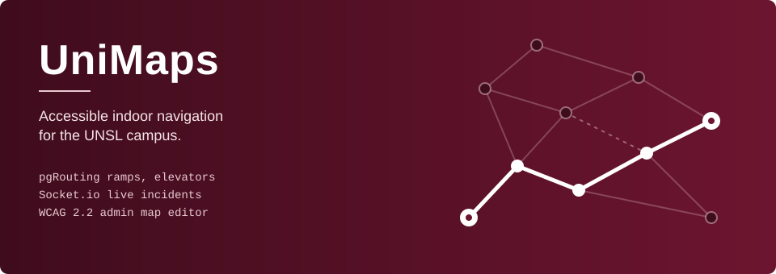

<p align="center">
  
</p>

<h1 align="center">Lucia Morandini</h1>

<p align="center">Software Engineer | Web Developer<br>San Luis, Argentina</p>

<p align="center">
  <a href="https://www.linkedin.com/in/luciamorandini"></a>
  <a href="mailto:luciamorandini23@gmail.com"></a>
  <a href="https://unimaps-pi.vercel.app"></a>
</p>

<br>

## About

```js
const lucia = {
  role: "Software Engineer",
  focus: ["Frontend", "Web accessibility"],
  location: "San Luis, Argentina",
  education: "Software Engineering, UNSL",
  learning: ["German (B1)", "AI applied to real products"],
  openToWork: true, // on-site in San Luis or remote
};
```

I build web applications, mostly on the frontend and with exposure to backend integration. Before writing code I like to understand the problem well and compare options until I find the one that fits best. I design with the people who will use the product in mind, with a special interest in **web accessibility**.

<br>

## Stack

<table>
  <tr>
    <td><b>Frontend</b></td>
    <td></td>
  </tr>
  <tr>
    <td><b>Backend</b></td>
    <td></td>
  </tr>
  <tr>
    <td><b>Data &amp; tools</b></td>
    <td></td>
  </tr>
</table>

<br>

## Featured project

<a href="https://unimaps-pi.vercel.app">
  
</a>

Undergraduate thesis, co-developed in a two-person team and currently live. Routes avoid stairs by using a graph of ramps, elevators and cross-floor connections; users report incidents in real time and admins edit maps, nodes and connections from a panel. Built following WCAG 2.2.

`React` `Next.js` `Node.js` `PostgreSQL` `pgRouting` `Socket.io` `Tailwind CSS`

<br>

<details>
<summary><b>Versión en español</b></summary>
<br>

Ingeniera en Informática de **San Luis, Argentina**. Desarrollo aplicaciones web, principalmente del lado frontend y con participación en la integración con el backend.

Antes de programar me interesa entender bien el problema y comparar opciones hasta encontrar la que mejor se adapta. Pienso cada solución en función de quienes la van a usar, con especial interés en la **accesibilidad web**.

- Buscando mi próximo trabajo como desarrolladora (presencial en San Luis o remoto)
- Aprendiendo alemán (B1) e IA aplicada a productos reales
- Ingeniera en Informática, Universidad Nacional de San Luis (UNSL)

</details>
