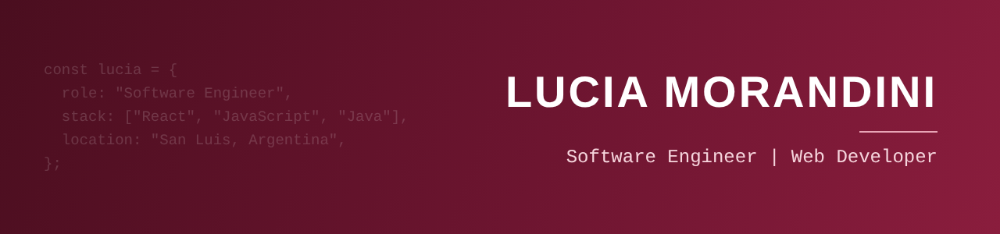

  

### Hi, I'm Lucia 👋

Software Engineer from **San Luis, Argentina**, with hands-on experience building web applications, mostly on the frontend and with exposure to backend integration.

Before writing code I like to understand the problem well, comparing options until I find the one that fits best. I design solutions with the people who will use them in mind, with a special interest in **web accessibility**.

- 🔭 Currently looking for my next role as a developer (on-site in San Luis or remote)
- 🌱 Learning: German (B1) and AI applied to real products
- 🎓 Software Engineering graduate, Universidad Nacional de San Luis (UNSL)

### 🛠️ Tech stack

   
   
  

### 🚀 Featured project

**[UniMaps](https://unimaps-pi.vercel.app)**: accessible indoor navigation for the UNSL campus. Undergraduate thesis project, co-developed by a two-person team and currently live.

- Accessible graph-based routing with pgRouting (ramps, elevators, cross-floor connections)
- Real-time incident reporting with Socket.io
- Admin panel for editing maps, nodes and connections
- Built following WCAG 2.2 accessibility guidelines

`React` `Next.js` `Node.js` `PostgreSQL` `pgRouting` `Socket.io` `Tailwind CSS`

### 📫 Contact

  
  

🇦🇷 <b>Versión en español</b>

 

Ingeniera en Informática de **San Luis, Argentina**, con experiencia en desarrollo de aplicaciones web, principalmente del lado frontend y con participación en la integración con el backend.

Antes de programar me interesa entender bien el problema y comparar opciones hasta encontrar la que mejor se adapta. Pienso cada solución en función de quienes la van a usar, con especial interés en la **accesibilidad web**.

- 🔭 Buscando mi próximo trabajo como desarrolladora (presencial en San Luis o remoto)
- 🌱 Aprendiendo: alemán (B1) e IA aplicada a productos reales
- 🎓 Ingeniera en Informática, Universidad Nacional de San Luis (UNSL)

